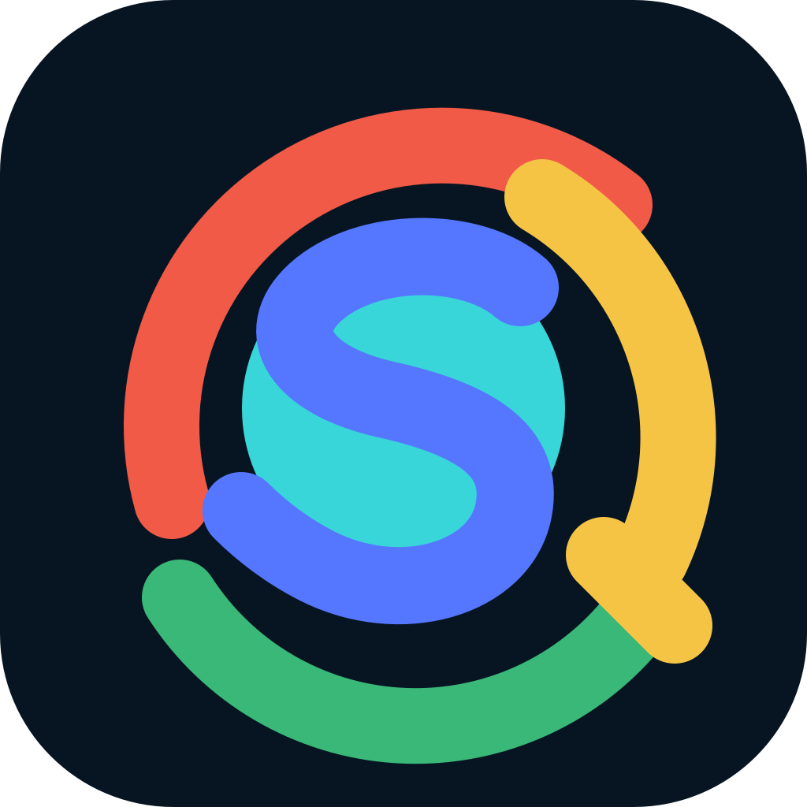

<p align="center">
  
</p>

<h1 align="center">SlyBrowser</h1>

<p align="center"><strong>Anti-detect Chromium for browser automation with Native Humanize.</strong></p>

<p align="center">
  <a href="LICENSE"></a>
  <a href="SECURITY.md"></a>
  
</p>

<p align="center">
  <a href="https://slybrowser.com/free-license"><strong>Get a Free license</strong></a> ·
  <a href="#quick-start">Quick start</a> ·
  <a href="docs/user-api.md">SDK API</a> ·
  <a href="docs/support-matrix.md">Support matrix</a>
</p>

SlyBrowser is a Chromium-based anti-detect browser for authorized browser automation,
testing and permitted web scraping. Use Python, Node.js, Java or .NET to launch
isolated browser profiles with persistent or clean state.

- **Native Humanize.** Mouse, keyboard and scrolling behavior executes in Sly
  WebDriver; SDKs expose the same interaction contract across four languages.
- **Native browser profiles.** Apply supported settings in the browser layer so
  pages, iframes and workers share one configuration.
- **Verified startup.** The SDK downloads the authorized Browser and exact matching
  Sly WebDriver, checks signatures and SHA-256 hashes, and starts the pair.

Free has no trial expiry and allows one concurrent browser process. It still
requires a valid authorization file and online authorization.

## Quick start

### Get your authorization file

1. Visit the [Free license page](https://slybrowser.com/free-license) and enter the
   email address that should receive your authorization file. Free can be claimed
   once per email and does not renew automatically.
2. Save the emailed file locally. The examples use `account.authorization.json` in
   the script's working directory; substitute the actual filename or path.

Treat this file as a credential. Keep it out of source control. Free remains subject
to signature, online authorization, revocation and concurrency checks.

### Install an SDK

Install the latest compatible SDK from the matching package registry.

| Language | Install |
| --- | --- |
| Node.js | `npm install slybrowser@latest` |
| Python | `python -m pip install --upgrade slybrowser` |
| Java | [SlyBrowser on Maven Central](https://central.sonatype.com/artifact/com.slybrowser/slybrowser) |
| .NET | `dotnet add package SlyBrowser` |

For Java, copy the current dependency declaration from Maven Central. Keep the
resolved SDK version in your project's dependency or lock file for reproducible builds.
See the [runtime and platform requirements](docs/support-matrix.md) before starting.

### Run your first browser

Python (save as `quickstart.py`):

```python
from slybrowser import launch

with launch("account.authorization.json", {
    "launch": {"headless": False},
    "humanize": {"enabled": True},
}) as browser:
    browser.get("https://example.com")
```

Node.js (save as `quickstart.mjs`):

```js
import { launch } from "slybrowser";

const browser = await launch("account.authorization.json", {
  launch: { headless: false },
  humanize: { enabled: true },
});
try {
  await browser.get("https://example.com");
} finally {
  await browser.close();
}
```

Run the Python script with `python quickstart.py`, or the Node.js example with
`node quickstart.mjs`. Each example opens the page in a visible browser, then closes
its session and releases its concurrency slot. Humanize is enabled for subsequent
mouse, keyboard and scrolling actions; opening a page alone does not exercise them.

On first launch, the SDK validates your authorization, selects an allowed release,
and downloads the Browser and matched Sly WebDriver for your platform. Browser
binaries are not embedded in the SDK package. Launch requires a signed,
catalog-published artifact for that exact platform and architecture. Verification
or pairing failure stops startup, with no fallback to system Chrome or a system Driver.

For more fields and all four language examples, see the
[SDK user API](docs/user-api.md). To troubleshoot authorization or release selection:

```text
slybrowser license info --authorization account.authorization.json
```

The Node.js and Python diagnostic command reports redacted plan, concurrency,
selected release and error information. It does not print license keys or tokens.

## Recorded test results

The [dated benchmark summary](docs/benchmark-latest.md) records selected passing
checks from 2026-08-16. The saved comparison used SlyBrowser/WebDriver
`148.0.7778.179` and stock Chromium `153.0.8003.0` on the same Windows x64 host,
network and time window. SlyBrowser used its matched WebDriver with Native Humanize;
the baseline used Playwright. The automation paths differed.

| Selected check | SlyBrowser | Stock Chromium |
| --- | ---: | ---: |
| Core automation signals | 100/100 | 80/100 |
| Page, frame and worker consistency | 100/100 | 94.44/100 |
| Device & Browser Info interaction | 100/100 | 69.23/100 |

These are historical results for the recorded configuration, not a guarantee that
every website or protection service will accept a session. Only selected passing
checks are shown; this is not a new test of the current release or a comparison
with another anti-detect product.

## Frameworks and profiles

| Path | Available bindings | Start here |
| --- | --- | --- |
| Sly WebDriver (default) | Node.js, Python, Java, .NET | [Shared launch API](docs/user-api.md) |
| Playwright (explicit adapter) | Node.js, Python, Java, .NET | [Compatibility matrix](contracts/automation-backends.json) |
| Puppeteer (explicit adapter) | Node.js/TypeScript | [Node.js SDK](packages/node/README.md) |

The default `launch` entry point starts Sly WebDriver. Choose a framework adapter
explicitly and follow its documented API; existing Playwright or Puppeteer code may
need changes. There is no implicit backend switch.

Use `launch.profileMode` and `launch.profileDirectory` to select persistent or
clean profiles. Supported identity, locale, timezone, graphics, audio and other
settings are documented in [Native profile configuration](docs/profile-configuration.md).
Unknown fields and unsupported settings are rejected.

Native Humanize stays in Sly WebDriver. See
[Humanize and runtime pairing](docs/webdriver-humanize-and-pairing.md) for supported
interaction behavior, presets and framework boundaries. Use `humanize.seed` only for
repeatable tests; omit it in normal use.

## Current support boundaries

SlyBrowser remains in private preview. Package names, APIs, download endpoints and
binary license terms may change before public preview.

- **Platforms:** consult the [support matrix](docs/support-matrix.md) for each
  target's status. SDK portability does not establish Browser/Driver availability;
  signed artifacts and release qualification are required for each exact tuple.
  32-bit x86 is unsupported.
- **Networking:** current first-release launch helpers use direct networking and
  reject proxy routing, proxy alignment, GEO/geolocation and WebRTC proxy/replace
  modes with `launch_feature_unsupported`.
- **Verification:** a missing or mismatched Browser/Driver, invalid signature,
  unavailable release, authorization denial or exceeded concurrency limit stops
  the operation. Unsupported configuration never silently falls back to another
  browser, driver, platform or network route.

## Licensing and authorization

Free is perpetual with one concurrent browser process and no trial expiry. Its
certificate still participates in signature, online authorization, revocation and
concurrency checks. Older time-limited Free certificates can be replaced through
the official claim page using the original email; revoked licenses cannot be
restored through that flow.

For a paid subscription, enter and confirm the delivery address at the
[official website](https://slybrowser.com/#pricing). The authorization file is sent
to the confirmed email only after payment is verified. A payment return page alone
does not grant access. An expired paid key returns `license_plan_expired` rather
than silently becoming Free. The service resolves the effective plan, allowed
release window and concurrency limit at launch and during runtime checks.

Prices and capacities are defined in [plans.json](contracts/plans.json). See
[licensing](docs/licensing.md) and [commercial policies](docs/legal-policies.md) for
details.

SDK code is MIT licensed. The browser implementation is private; distributed
binaries have a separate binary license and applicable open-source notices.
Brand assets retain their trademark restrictions. Read
[LICENSE-SCOPE.md](LICENSE-SCOPE.md), [BINARY-LICENSE.md](legal/BINARY-LICENSE.md)
and [LICENSE](LICENSE) before redistribution. Chromium and bundled third-party
components retain their own licenses and notices.

## Documentation

- [SDK API and four-language examples](docs/user-api.md)
- [Node.js](packages/node/README.md), [Python](packages/python/README.md),
  [Java](packages/java/README.md) and [.NET](packages/dotnet/README.md)
- [Installation, configuration and troubleshooting](docs/wiki/Home.md)
- [Platform and runtime support](docs/support-matrix.md)
- [Native profile configuration](docs/profile-configuration.md)
- [Native Humanize and runtime pairing](docs/webdriver-humanize-and-pairing.md)
- [Authorization and signed release delivery](docs/authorized-release-service.md)
- [Dated benchmark summary](docs/benchmark-latest.md)
- [Contribution and delivery contracts](contracts/delivery/README.md)

Use SlyBrowser only on systems and websites you own or are authorized to automate.
Credential attacks, unauthorized access, fraud and evasion of access controls are
not supported. Report vulnerabilities through [SECURITY.md](SECURITY.md).

If SlyBrowser is useful to you, consider starring the repository or following
[releases](https://github.com/virtualfanc/slybrowser/releases) for updates.

SlyBrowser is an independent project built from Chromium source. It is not Google
Chrome, is not affiliated with Google and does not ship Google Chrome branding.
Chromium and Google Chrome are trademarks of their respective owners.
